# Class Activity 1 — System Calls in Practice

- **Student Name:** Vuon Sethar Tykun
- **Student ID:** E20230389
- **Date:** 11/10/2026

---

## Warm-Up: Hello System Call

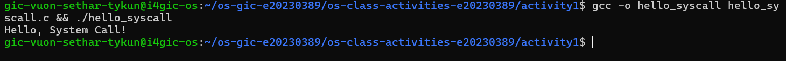
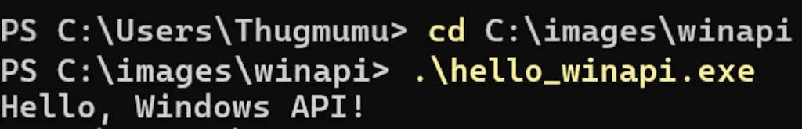
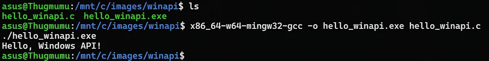
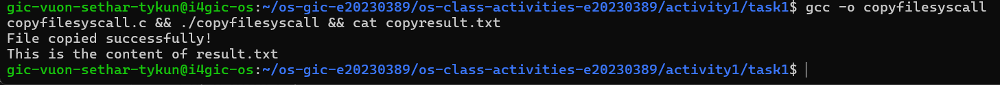

---

## Task 1: File Creator & Reader

### Part A — File Creator

**Describe your implementation:**

I created a file using the `open()` system call. I specified the file name, access flags, and permission mode. Then, I used `write()` to write text into the file and `close()` to close the file descriptor.

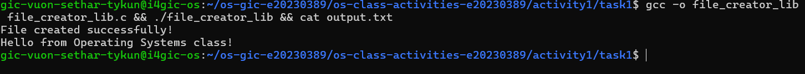
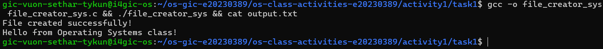

1. **What flags did you pass to `open()`? What does each flag mean?**

   > I used `O_WRONLY | O_CREAT | O_TRUNC`. `O_WRONLY` opens the file for writing only. `O_CREAT` creates the file if it does not exist. `O_TRUNC` clears the file if it already exists.

2. **What is `0644`? What does each digit represent?**

   > `0644` is the file permission mode in octal. The first digit `0` indicates octal notation. The owner has permission `6` (read and write), the group has `4` (read only), and others have `4` (read only). These permissions can also be affected by the process's umask.

3. **What does `fopen("output.txt", "w")` do internally that you had to do manually?**

   > `fopen()` performs the lower-level file operations for me. It opens or creates the file, truncates it if it already exists, and returns a `FILE` stream. With system calls, I must use `open()`, `write()`, and `close()` myself.

### Part B — File Reader & Display

**Describe your implementation:**

I opened the file in read-only mode using `open()`. I used `read()` to get bytes from the file into a buffer and `write()` to display those bytes. I repeated the process until the end of the file.

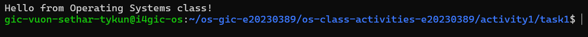
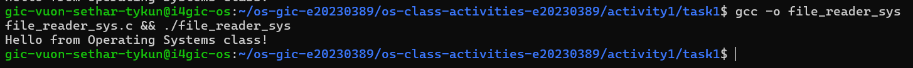

1. **What does `read()` return? How is this different from `fgets()`?**

   > `read()` returns the number of bytes read, `0` at the end of the file, or `-1` if an error occurs. `fgets()` reads a line or a specified maximum number of characters into a string and adds a null terminator when successful.

2. **Why do you need a loop when using `read()`? When does it stop?**

   > A single `read()` may not read the entire file. A loop is needed to continue reading the remaining bytes. It stops when `read()` returns `0` (end of file) or when an error occurs.

---

## Task 2: Directory Listing & File Info

**Describe your implementation:**

I used directory functions to open and list the contents of a directory. For each entry, I used `stat()` to retrieve information such as file size, type, permissions, and timestamps. I formatted numeric values as text before displaying them.

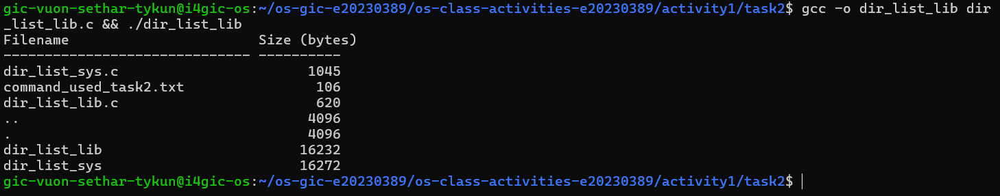
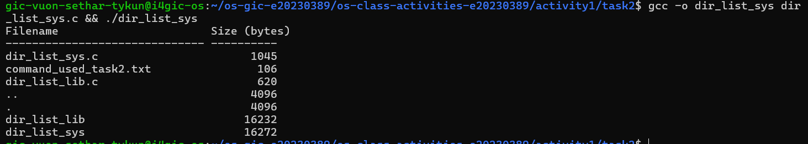

1. **What struct does `readdir()` return? What fields does it contain?**

   > `readdir()` returns a pointer to a `struct dirent`. Important fields include `d_name`, the entry's name, and `d_ino`, its inode number. It may also contain `d_type`, which indicates the entry type when supported.

2. **What information does `stat()` provide beyond file size?**

   > `stat()` provides the file type, permissions, inode number, owner user ID, group ID, number of links, and access, modification, and status-change timestamps.

3. **Why can't you `write()` a number directly — why do you need `snprintf()` first?**

   > `write()` writes bytes from a memory buffer; it does not convert integers into readable text. `snprintf()` converts the number into a string in a buffer, which can then be passed to `write()`.

---

## Task 3: strace Analysis

**Describe what you observed:**

I used `strace` to observe the system calls made by the library-based and system-call-based programs. The output shows the operations performed by the program when opening, reading, writing, and closing files.

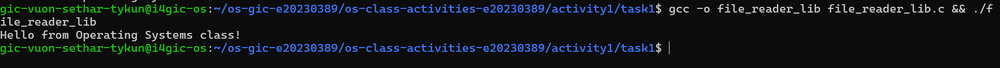
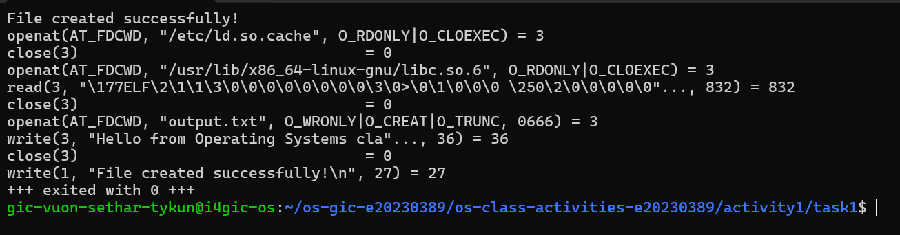
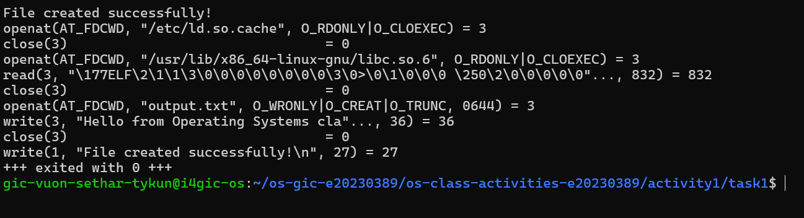
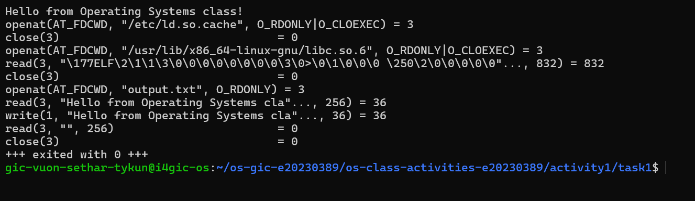
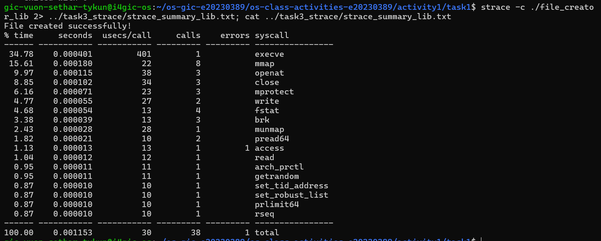
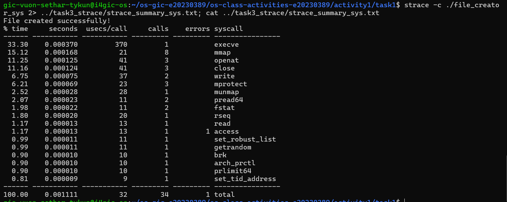

1. **How many system calls does the library version make compared to the system call version?**

   > According to my `strace -c` results, the library version made **[insert total]** system calls, while the system-call version made **[insert total]** system calls. The exact counts depend on the program and its runtime environment.

2. **What extra system calls appear in the library version? What do they do?**

   > The library version may make additional system calls during program startup and runtime, such as memory mapping, memory protection, and file-status checks. These are used to load libraries, initialize the C runtime, and manage resources. The exact extra calls can be seen in my `strace` output.

3. **How many `write()` calls does `fprintf()` actually produce?**

   > According to my `strace` output, `fprintf()` produced **[insert number]** `write()` calls. The number depends on buffering and when the output is flushed.

4. **In your own words, what is the real difference between a library function and a system call?**

   > A library function is a function provided by a library to make programming easier. It may perform work in user space or call one or more system calls. A system call is the interface through which a program requests a service from the operating-system kernel, such as reading or writing a file.

---

## Task 4: Exploring OS Structure

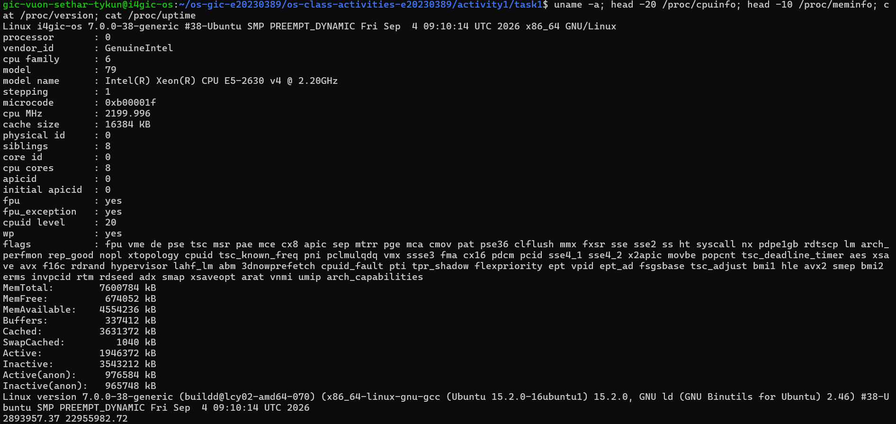
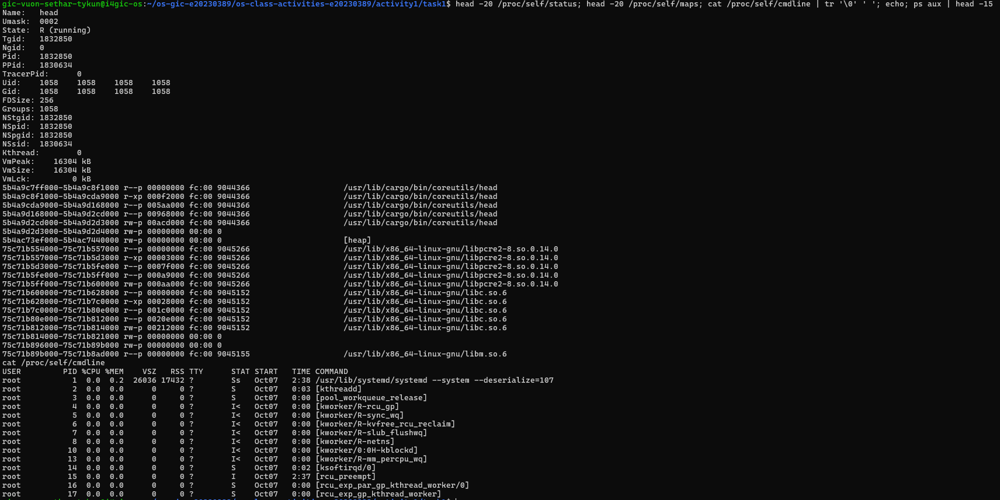
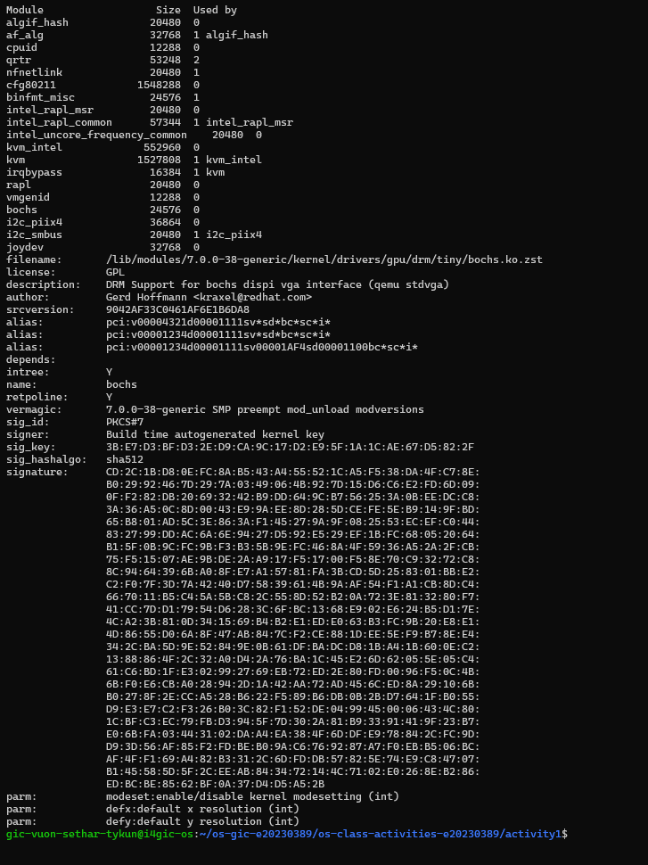
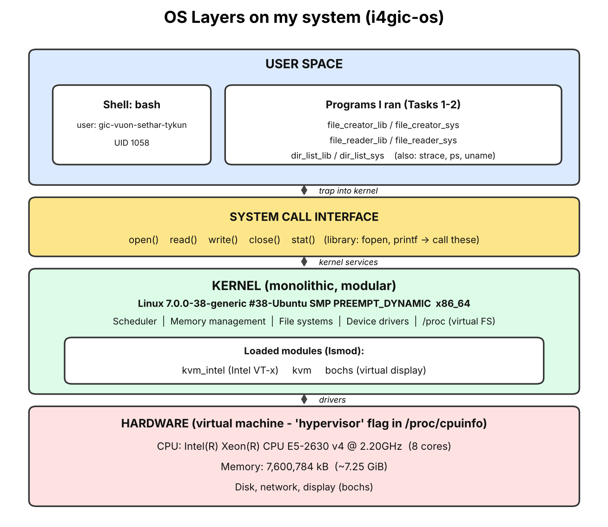

1. **What is `/proc`? Is it a real filesystem on disk?**

   > `/proc` is a virtual filesystem provided by the Linux kernel. It exposes information about processes and the system. It is not a normal filesystem stored on disk; its contents are generated by the kernel.

2. **Monolithic kernel vs. microkernel — which type does Linux use?**

   > Linux uses a monolithic kernel. Most core operating-system services, including device drivers and filesystem support, run in kernel space. Linux also supports loadable kernel modules.

3. **What memory regions do you see in `/proc/self/maps`?**

   > The memory map can show executable code (`text`), read-only data, writable data, heap, shared libraries, memory-mapped regions, and the stack. The exact regions depend on the process.

4. **Break down the kernel version string from `uname -a`.**

   > The output contains the kernel name, host name, kernel release, kernel version/build information, machine architecture, processor information, and operating-system identification. The kernel release commonly has a version format such as `major.minor.patch`, followed by additional build or distribution information.

5. **How does `/proc` show that the OS is an intermediary between programs and hardware?**

   > `/proc` provides information about processes and hardware-related system resources through the kernel. Programs can inspect this information without directly accessing hardware. This demonstrates that the operating system manages resources and provides a controlled interface between applications and the hardware.

---

## Reflection

> In this activity, I learned how programs interact with the operating system through system calls. I practiced creating, reading, and writing files, listing directory contents, and retrieving file information. I also used `strace` to observe system calls and explored the Linux `/proc` filesystem. This activity helped me understand the difference between library functions and system calls, and how the Linux kernel manages system resources.
