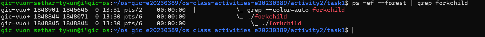
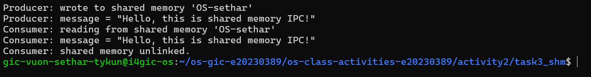
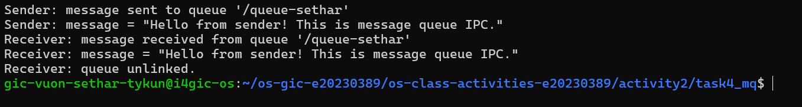

# Class Activity 2 — Processes & Inter-Process Communication

- **Student Name:** Vuon Sethar Tykun
- **Student ID:** E20230389
- **Date:** 11/10/2026

---

## Task 1: Process Creation on Linux (fork + exec)

### Compilation & Execution


### Process Tree



### Output

```
Parent process (PID: 1849131) — creating child...
Parent: waiting for child (PID: 1849132) to finish...
Child process (PID: 1849132, Parent PID: 1849131)
Child: sleeping 30s — observe the process tree now!
Child: now executing 'ls -la'...
total 40
drwxrwxr-x 2 gic-vuon-sethar-tykun gic-vuon-sethar-tykun  4096 Nov 10 13:32 .
drwxrwxr-x 7 gic-vuon-sethar-tykun gic-vuon-sethar-tykun  4096 Nov 10 13:12 ..
-rw-rw-r-- 1 gic-vuon-sethar-tykun gic-vuon-sethar-tykun   971 Nov 10 13:31 command_used_forkchild.txt
-rwxrwxr-x 1 gic-vuon-sethar-tykun gic-vuon-sethar-tykun 16392 Nov 10 13:32 forkchild
-rw-rw-r-- 1 gic-vuon-sethar-tykun gic-vuon-sethar-tykun  1320 Nov 10 13:13 forkchild.c
-rw-rw-r-- 1 gic-vuon-sethar-tykun gic-vuon-sethar-tykun   243 Nov 10 13:33 result_forkchild.txt
Parent: child exited with status 0
Parent: done.
```

### Questions

1. **What does `fork()` return to the parent? What does it return to the child?**

   > `fork()` returns the child's PID to the parent process. It returns `0` to the child process. If an error occurs, it returns `-1` to the parent.

2. **What happens if you remove the `waitpid()` call? Why might the output look different?**

   > Without `waitpid()`, the parent does not wait for the child to finish. Both processes may run at the same time, so their output can appear in a different order. The child may also become a zombie process if it finishes before the parent collects its exit status.

3. **What does `execlp()` do? Why don't we see "execlp failed" when it succeeds?**

   > `execlp()` replaces the current process image with a new program. If it succeeds, it does not return to the original program. The message "execlp failed" is only displayed if the function fails.

4. **Draw the process tree for your program (parent → child). Include PIDs from your output.**

   > The process tree has the parent process at the top and the child process below it. The child is created using `fork()`. The actual PIDs are shown in my program output and process tree screenshot.

   ```text
   Parent Process (PID: 1849131)
   └── Child Process (PID: 1849132)
       └── Executed Program
   ```

5. **Which command did you use to view the process tree (`ps --forest`, `pstree`, or `htop`)? What information does each column show?**

   > I used `ps --forest` to view the process tree. The PID column shows the process ID, PPID shows the parent process ID, and CMD shows the command used to start the process. The tree indentation shows the parent-child relationship.

---

## Task 2: Process Creation on Windows

### Compilation & Execution


### Task Manager Screenshots


### Questions

1. **What is the key difference between how Linux creates a process (`fork` + `exec`) and how Windows does it (`CreateProcess`)?**

   > Linux commonly uses `fork()` to create a child process that initially has a copy of the parent's process state, followed by `exec()` to replace the child with another program. Windows uses `CreateProcess()` to create a new process and its primary thread directly, with the executable specified in the function call.

2. **What does `WaitForSingleObject()` do? What is its Linux equivalent?**

   > `WaitForSingleObject()` waits until a specified object becomes signaled or a timeout occurs. When waiting for a process to finish, its Linux equivalent is `waitpid()`.

3. **Why do we need to call `CloseHandle()` at the end? What happens if we don't?**

   > `CloseHandle()` releases a handle to a Windows resource, such as a process or thread. If we do not close handles, the program may leak resources and use up system handle limits.

4. **In Task Manager, what was the PID of your parent program and the PID of mspaint? Do they match your program's output?**

   > The parent program PID was [Parent PID], and the mspaint PID was [mspaint PID]. These should match the PIDs printed by my program and shown in Task Manager.

5. **Compare the Processes tab (tree view) and the Details tab (PID/PPID columns). Which view makes it easier to understand the parent-child relationship? Why?**

   > The Processes tab makes the parent-child relationship easier to understand because it displays processes in a hierarchical tree. The Details tab provides exact PID and PPID values, which are useful for identifying and comparing processes.

---

## Task 3: Shared Memory IPC

### Compilation & Execution



### Output

```
Consumer: reading from shared memory 'OS-sethar'
Consumer: message = "Hello, this is shared memory IPC!"
Consumer: shared memory unlinked.
```

### Questions

1. **What does `shm_open()` do? How is it different from `open()`?**

   > `shm_open()` creates or opens a named shared-memory object that can be accessed by multiple processes. Unlike `open()`, which is used for regular files and other filesystem objects, `shm_open()` is specifically designed for POSIX shared memory.

2. **What does `mmap()` do? Why is shared memory faster than other IPC methods?**

   > `mmap()` maps an object into a process's virtual memory. Shared memory is often faster than other IPC methods because multiple processes can access the same memory region directly without repeatedly copying data through the kernel.

3. **Why must the shared memory name match between producer and consumer?**

   > Both processes must use the same shared-memory name to access the same shared-memory object. If the names are different, they will access different objects or fail to open the expected object.

4. **What does `shm_unlink()` do? What would happen if the consumer didn't call it?**

   > `shm_unlink()` removes the name of a shared-memory object. If the consumer does not call it, the object may remain available under its name after the processes finish, until it is unlinked or the system cleans it up.

5. **If the consumer runs before the producer, what happens? Try it and describe the error.**

   > If the shared-memory object has not been created yet, the consumer may fail when calling `shm_open()` with `O_CREAT` omitted. The error is usually `ENOENT`, meaning that the shared-memory object does not exist. The producer must create the object before the consumer opens it.

---

## Task 4: Message Queue IPC

### Compilation & Execution



### Output

```
Receiver: message received from queue '/queue-sethar'
Receiver: message = "Hello from sender! This is message queue IPC."
Receiver: queue unlinked.
```

### Questions

1. **How is a message queue different from shared memory? When would you use one over the other?**

   > A message queue transfers data as separate messages, while shared memory allows processes to access the same memory region. Message queues are useful for structured messages and simpler communication. Shared memory is useful for transferring large amounts of data efficiently.

2. **Why does the queue name in `common.h` need to start with `/`?**

   > POSIX message queue names must begin with a slash (`/`). The slash identifies the name as a POSIX message queue name.

3. **What does `mq_unlink()` do? What happens if neither the sender nor receiver calls it?**

   > `mq_unlink()` removes the name of a message queue. If neither the sender nor receiver calls it, the queue may remain in the system and continue using resources until it is unlinked or cleaned up.

4. **What happens if you run the receiver before the sender?**

   > If the receiver opens or creates the queue and then waits for a message, it may block until the sender sends one. If the receiver tries to open a queue that does not exist without using `O_CREAT`, it will fail with an error such as `ENOENT`.

5. **Can multiple senders send to the same queue? Can multiple receivers read from the same queue?**

   > Yes, multiple senders can send messages to the same message queue. Multiple receivers can also access the same queue, but each message is normally received by only one receiver. The messages are not automatically copied to every receiver.

---

## Reflection

> In this activity, I learned how processes are created and managed in Linux and Windows. I practiced using `fork()`, `exec()`, `CreateProcess()`, and process-waiting functions. I also learned how processes communicate using shared memory and message queues. This activity helped me understand process relationships, synchronization, and inter-process communication in operating systems.
