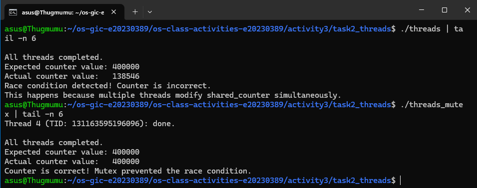
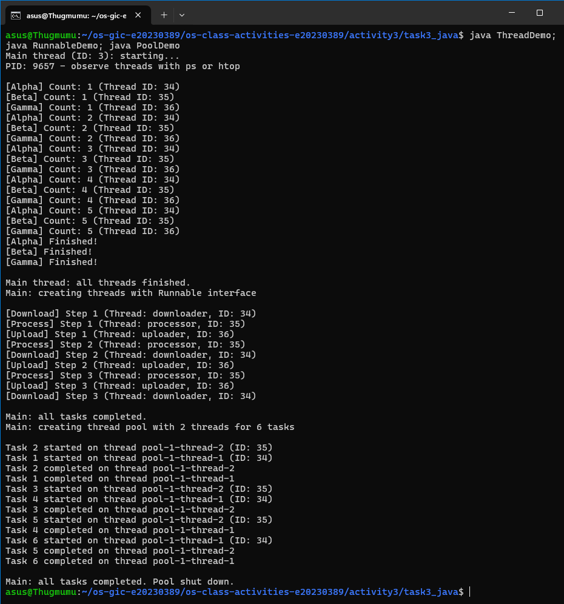

# Class Activity 3 — Socket Communication & Multithreading

- **Student Name:** Your Real Name
- **Student ID:** e20230389
- **Date:** 2026-11-17

---

## Task 1: TCP Socket Communication (C)

### Compilation & Execution

### Answers

1. **Role of `bind()` / Why client doesn't call it:**
   > `bind()` attaches the server socket to a local IP address and port (8080), so clients know where to reach the server. The client does not need it because it only starts a connection. The OS automatically gives it a temporary port, and nobody needs to find the client.

2. **What `accept()` returns:**
   > It returns a new file descriptor for the connected client. The original server socket keeps listening for more connections, while the new descriptor is used with `read()` and `send()` to talk to that one client.

3. **Starting client before server:**
   > The client prints `connect: Connection refused`, because no process is listening on port 8080 yet.

4. **What `htons()` does:**
   > It converts the 16-bit port number from the host's byte order (little-endian on x86) to network byte order (big-endian). Different machines store bytes in different orders, so the network uses one agreed order.

5. **Socket call sequence:**
   > **Server:** `socket()` → `bind()` → `listen()` → `accept()` → `read()` / `send()` → `close()`
   > **Client:** `socket()` → `connect()` → `send()` / `read()` → `close()`

---
## Task 2: POSIX Threads (C)

### Output — Without Mutex (Race Condition) and With Mutex (Correct)

Without the mutex, the counter came out as 138546 (and 181012, 126509, 249816 in other runs) instead of 400000. With the mutex it was exactly 400000 every time.

### Answers

1. **What is a race condition?**
   > A race condition happens when several threads read and write the same variable at the same time without coordination, so the result depends on timing. `shared_counter++` is really three steps (read, add, write). Threads interleave these steps and overwrite each other's updates, so many increments are lost.

2. **What does `pthread_mutex_lock()` do?**
   > It lets only one thread into the protected section at a time. Other threads wait until the owner calls `pthread_mutex_unlock()`. Each `shared_counter++` then finishes completely before the next one begins, so no updates are lost.

3. **Removing `pthread_join()`:**
   > REPLACE_WITH_WHAT_YOU_SAW

4. **Thread vs Process:**
   > Threads in one process share the code, global data, heap and open files. Each thread has its own stack, registers and thread ID. Separate processes have separate address spaces, so they share nothing by default.

---
## Task 3: Java Multithreading

### ThreadDemo, RunnableDemo and PoolDemo Output

ThreadDemo: Alpha, Beta and Gamma (thread IDs 34, 35, 36) printed their counts interleaved. RunnableDemo showed the same with named threads (downloader, processor, uploader). PoolDemo used only pool-1-thread-1 and pool-1-thread-2, running the 6 tasks two at a time.

### Answers

1. **Thread vs Runnable:**
   > Extending `Thread` makes the task and the thread one class, and uses up Java's single inheritance, so the class cannot extend anything else. Implementing `Runnable` only describes the work, and any `Thread` or thread pool can run it. I prefer `Runnable` in most cases, because it separates the task from how it is run and allows the class to extend another class.

2. **Pool size limiting concurrency:**
   > `newFixedThreadPool(2)` creates only two worker threads. The six tasks are put in a queue, and each worker takes the next task when it finishes one. That is why the output shows tasks 1 and 2, then 3 and 4, then 5 and 6, always on the same two threads.

3. **thread.join() in Java:**
   > `join()` makes the calling thread wait until the other thread has finished. When I removed the `join()` calls, REPLACE_WITH_WHAT_YOU_SAW

4. **ExecutorService advantages:**
   > It reuses a fixed number of threads instead of creating a new thread for every task, which saves the cost of creating threads. It limits how many run at once, queues extra tasks, and manages shutdown and results in one place. With many tasks, this avoids running out of memory or overloading the CPU.

---
