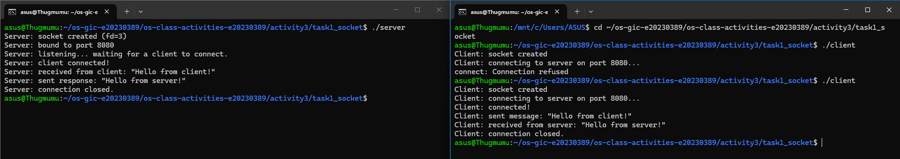

# Class Activity 3 — Socket Communication & Multithreading

- **Student Name:** Your Real Name
- **Student ID:** e20230389
- **Date:** 2026-11-17

---

## Task 1: TCP Socket Communication (C)

### Compilation & Execution

### Answers

1. **Role of `bind()` / Why client doesn't call it:**
   > `bind()` attaches the server socket to a local IP address and port (8080), so clients know where to reach the server. The client does not need it because it only starts a connection. The OS automatically gives it a temporary port, and nobody needs to find the client.

2. **What `accept()` returns:**
   > It returns a new file descriptor for the connected client. The original server socket keeps listening for more connections, while the new descriptor is used with `read()` and `send()` to talk to that one client.

3. **Starting client before server:**
   > The client prints `connect: Connection refused`, because no process is listening on port 8080 yet.

4. **What `htons()` does:**
   > It converts the 16-bit port number from the host's byte order (little-endian on x86) to network byte order (big-endian). Different machines store bytes in different orders, so the network uses one agreed order.

5. **Socket call sequence:**
   > **Server:** `socket()` → `bind()` → `listen()` → `accept()` → `read()` / `send()` → `close()`
   > **Client:** `socket()` → `connect()` → `send()` / `read()` → `close()`

---
