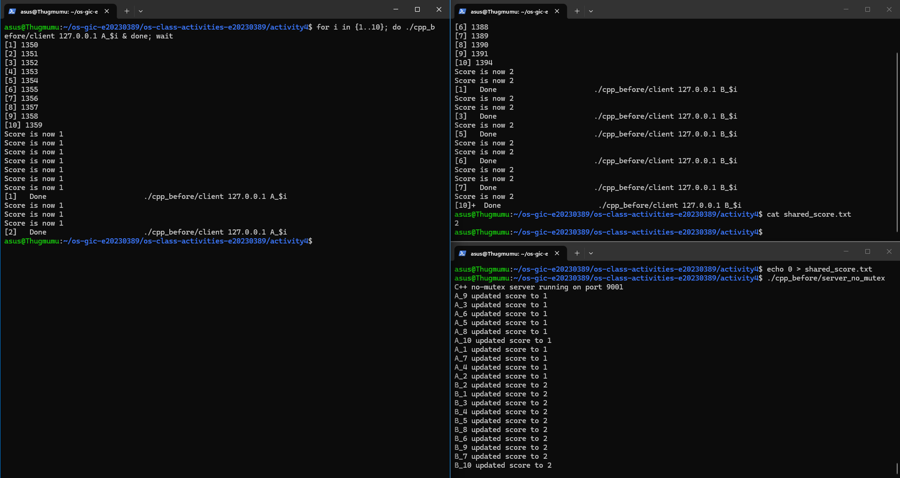
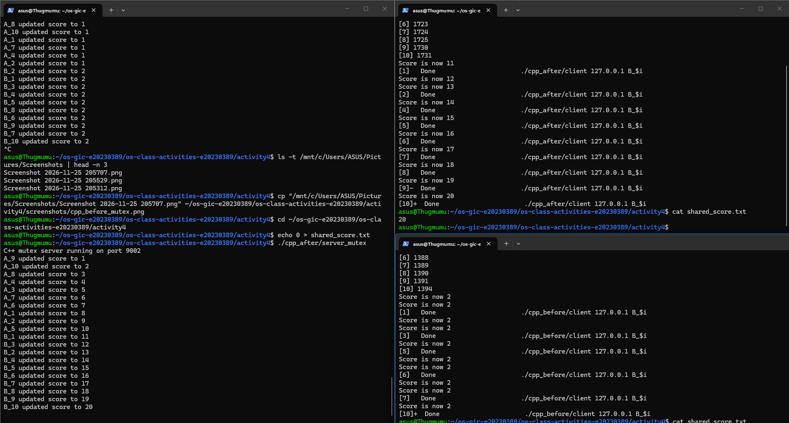
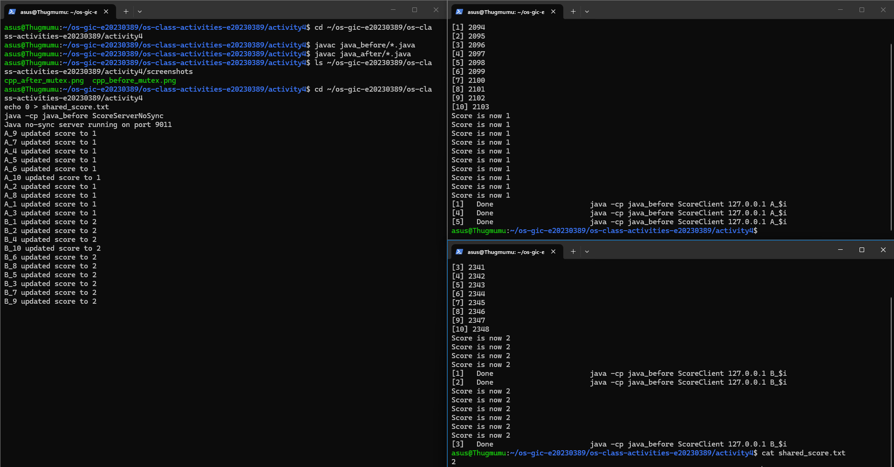
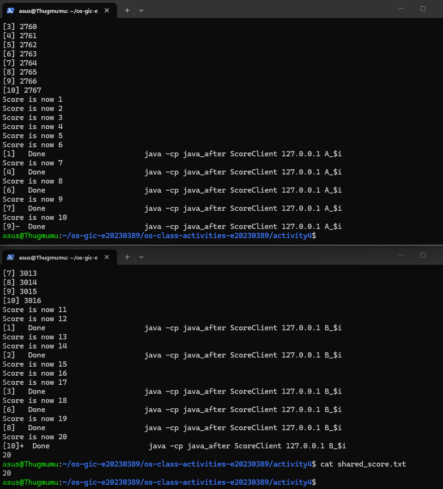

# Class Activity 4 — Shared File API

- **Student Name:** VUON SETHAR TYKUN
- **Student ID:** e20230389
- **Partner Name:** None (worked alone)
- **Partner Student ID:** None
- **Server Machine Owner:** VUON SETHAR TYKUN
- **Server IP Address:** 127.0.0.1 (localhost)

> **Note:** I had no partner machine, so I ran everything on one PC (WSL Ubuntu). Student A and Student B were two separate client terminals, each sending 10 requests at the same time to the server in a third terminal.

---

## Task 1: C++ Before Mutex

- Expected score after 20 total client requests: 20
- Actual score: 2
- What happened: Many server threads read the file at the same time, before any of them wrote it back. They all computed the same new value, so most updates were lost. This is a race condition.

---

## Task 2: C++ After Mutex

- Expected score after 20 total client requests: 20
- Actual score: 20
- What changed after adding mutex: `std::lock_guard<std::mutex>` lets only one thread update the file at a time, so no update is lost and the score is correct.

---

## Task 3: Java Before Synchronized

- Expected score after 20 total client requests: 20
- Actual score: 2
- What happened: The server starts a thread for each client, and the threads read and write the file at the same time, so most updates were lost.

---

## Task 4: Java After Synchronized

- Expected score after 20 total client requests: 20
- Actual score: 20
- What changed after adding synchronized: `synchronized` on `updateScore` lets only one thread run it at a time, so the read, sleep and write sequence is not interrupted and the score is correct.

---

## Questions

1. **Why should clients send requests to the server instead of writing the file directly?**
   > Only the server touches the file, so the rules for updating it are in one place. Clients cannot corrupt it by writing at the same time, and the server can add locking in one place instead of every client needing it.

2. **Why does the server still have a race condition before mutex or synchronized?**
   > The server creates one thread per client, so several threads run the update at the same time. Each reads the old value, waits 200 ms, and writes old value + 1, so they overwrite each other's work. My result of 2 instead of 20 shows it.

3. **In the C++ fixed version, what does `std::lock_guard<std::mutex>` protect?**
   > It protects the whole update in `update_score`: reading the file, sleeping, adding 1, and writing the file back. This is the critical section. The lock is released automatically when the function ends.

4. **In the Java fixed version, what does `synchronized` protect?**
   > It protects the `updateScore` method, which reads, increments and writes the file. Because the method is static, the lock belongs to the class, so only one thread can be inside it at a time.

5. **Why is the final score expected to be 20 when Student A sends 10 requests and Student B sends 10 requests?**
   > The file starts at 0 and every request adds exactly 1. With 10 + 10 = 20 requests, the correct final score is 20, as long as no update is lost.

6. **What could happen if two separate servers update the same file at the same time?**
   > Each server has its own mutex or lock inside its own process, so they cannot protect each other. Both could read the same value and write over each other, losing updates, or write at the same moment and corrupt the file. It would need a file lock shared by both, or just one server.

---

## Reflection

In C++ I used `std::lock_guard<std::mutex>` around the update, and in Java I used the `synchronized` keyword on the method. Both make the read, increment and write one step that only one thread can do at a time. Java's keyword is shorter, while C++ needs an explicit mutex object, but lock_guard releases it automatically. The big lesson is that a shared resource needs one controlled path, and even a single server needs a lock when it handles clients in several threads.
