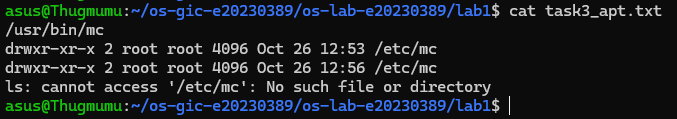
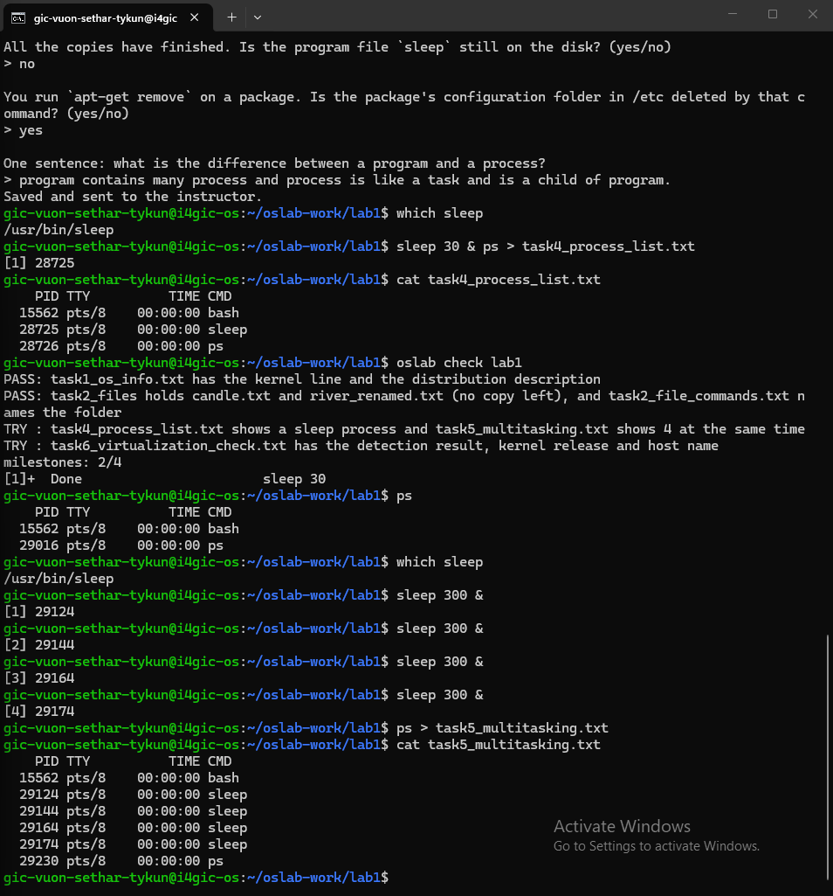
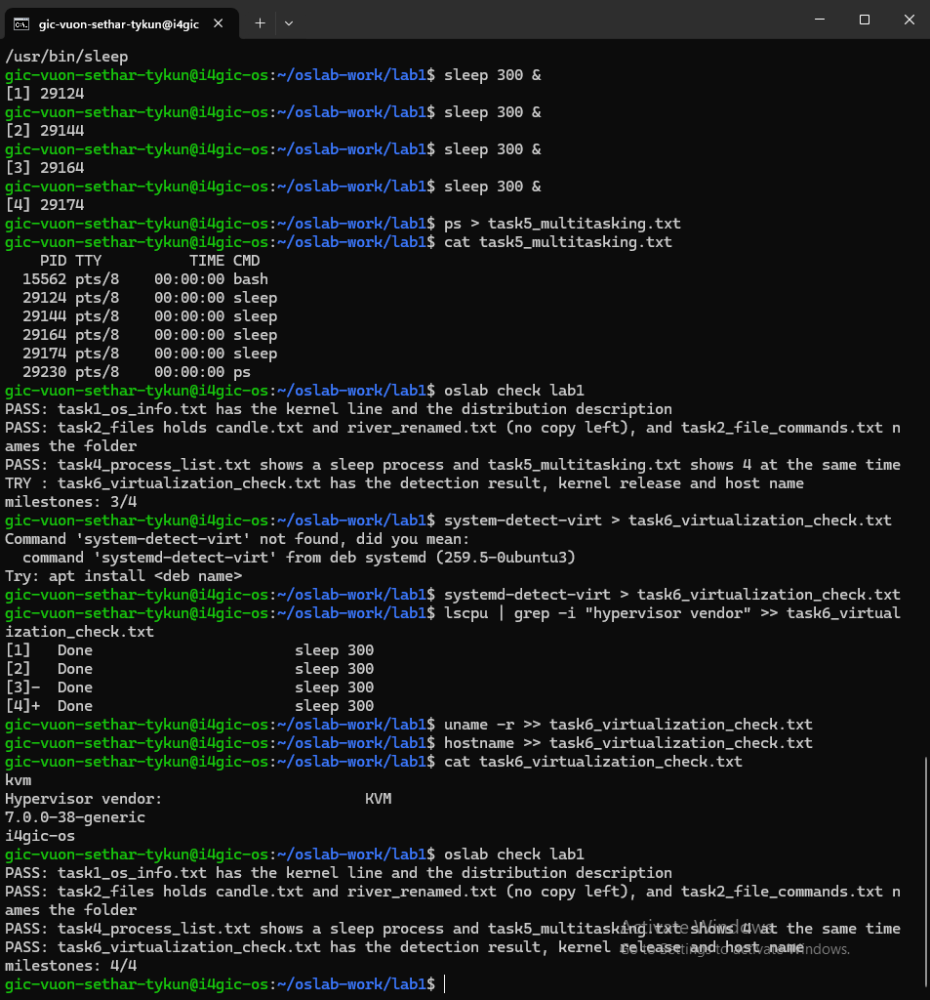

# Lab 1 Report: e20230389

## Task 1: Kernel and distribution
- Kernel version: (from `uname -a`, e.g. 7.0.0-38-generic)
- Ubuntu version: (from `lsb_release -a`)

## Task 3: Remove vs purge
After remove, /etc/mc was still there (settings kept). After purge, it was gone.

## Task 4: Program vs process
Program = file on disk (/usr/bin/sleep). Process = that program while running.
Before: ..., during: ..., after: the process was gone but `which sleep` still printed the path.

## Task 5: Multitasking
I started COUNT sleep processes and ps showed them at the same time.

## Task 6: Virtual machine?
systemd-detect-virt said: ... which means ...

## Prediction note
I predicted `which sleep` would print nothing after the processes finished. Corrected: it still prints a path, because the program stays on disk.

